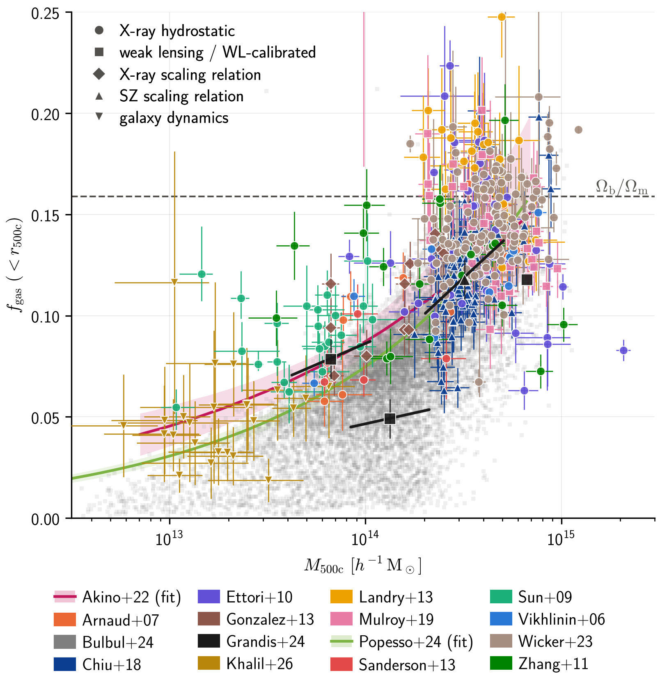

# BaryCon — Baryon Constraints in galaxy groups and clusters

*An open, community-maintained collection of gas, stellar and baryon fractions in galaxy
groups and clusters, with explicit and traceable homogenisation, plotting and fitting.*

G. Aricò & M. Douspis and contributors.



Baryon fractions of groups and clusters are the main external data used to calibrate
baryonic feedback in hydrodynamical simulations, emulators and weak-lensing analyses.
Published measurements use different cosmologies, overdensities (r2500c, r500c, r200c,
shells), total-mass estimators (hydrostatic, lensing, scaling relations, dynamics) and
stellar IMFs. BaryCon stores each measurement **as published**, together with every
assumption needed to interpret it, and lets you homogenise, plot and fit them **explicitly**.

## Install

```bash
pip install git+https://github.com/garico92/barycon   # until the PyPI release
pip install -e ".[dev]"                                               # from a clone
```

## Quick start: dictionary interface (`BaryonFractions`)

Everything is already converted to the target
cosmology (Planck18 by default) and masses are in M☉/h.

```python
from barycon import BaryonFractions          # `from baryon_fractions import ...` still works
import matplotlib.pyplot as plt

bf = BaryonFractions()                        # or BaryonFractions(hubble=0.7)
fig, ax = bf.plot_gas_fractions_M()           # f_gas vs M500
fig, ax = bf.plot_gas_fractions_z()           # f_gas vs redshift
fig, ax = bf.plot_stellar_fractions()

d = bf.gas_data["wicker_2022"]                # M500, M500_p/m/err, f_gas, f_gas_p/m/err, redshift, reference
akino = bf.gas_fits["akino_2022"]             # M500, f_gas, f_gas_m, f_gas_p (band)

popt, pcov = bf.fit(["wicker_2022", "arnaud_2007"], fit_type="gas_frac_M_double", scatter=True)
bf.plot_best_fit(data=["wicker_2022", "arnaud_2007"])
```

## Quick start: metadata interface (`barycon.load`)

```python
import barycon as bc

col = bc.load()                                    # every entry
col.summary().pprint(max_lines=-1)                 # cosmology, aperture, mass proxy, z, IMF, status

gas = col.filter(quantity="f_gas", delta="500c", region="sphere")
gas = gas.homogenize(cosmology="Planck18")         # explicit and logged
print(gas["Vikhlinin2006"].history)
ax = gas.plot("f_gas", universal=0.157)            # x="z" for redshift
ax = gas.plot("f_gas", x="z")

# overdensity changes are model dependent: you must say what you assume
g200 = gas.filter(data_type="points").to_delta("200c", eta_gas=0.3)

# hydrostatic-bias correction, IMF
hse = gas.filter(mass_proxy="hydrostatic")
hse_b = bc.Collection(e.apply_hse_bias(0.2) for e in hse)
stars = col.filter(quantity="f_star").to_imf("chabrier")

# fitting (power_law | saturating | double_power_law_z), optionally with intrinsic scatter
res = hse.fit("saturating", scatter=True)
print(res.summary()); res.plot()

tab = gas.to_table("f_gas", h_units=True)         # one long table for your own fits
print(col.bibtex())                                # cite what you use
```

Command line: `barycon list --quantity f_star`, `barycon info Kravtsov2018`,
`barycon validate my_entry.ecsv`.

## Contents (data release 2026.11.0)

20 publications, 25 entries, ~11,000 systems, 10¹¹–10¹⁵·⁵ M☉, 0 < z < 1.3.
`(?)` in plots = `status: needs_check` (an open question is documented in the entry).
Per-entry assumptions: [`docs/homologation.md`](docs/homologation.md).

| id | quantities | aperture | total mass | z | N | reference |
|---|---|---|---|---|---|---|
| Khalil2026, Khalil2026_200c | f_gas | r500c, r200c | dynamical? | 0.01–0.03 | 24/22 | [arXiv:2608.17735](https://arxiv.org/abs/2608.17735) |
| Popesso2024, Popesso2024_200c | f_gas (fit) | r500c, r200c | mixed | ≲0.2 | fit | [doi:10.1051/0004-6361/202453256](https://doi.org/10.1051/0004-6361/202453256) |
| Bulbul2024 | f_gas | r500c | X-ray SR (WL-cal.) | 0–1.3 | 10440 | [doi:10.1051/0004-6361/202348264](https://doi.org/10.1051/0004-6361/202348264) |
| Grandis2024 | f_gas, f★ (fits at their pivot, with local slope) | r500c | compilation | 0–1.3 | 4 surveys | [doi:10.1093/mnras/stae259](https://doi.org/10.1093/mnras/stae259) |
| Wicker2023 | f_gas | r500c | HSE | 0.06–0.55 | 120 | [doi:10.1051/0004-6361/202243922](https://doi.org/10.1051/0004-6361/202243922) |
| Akino2022 | f_gas, f★, f_BCG (fits) | r500c | WL | 0–1 | fit | [doi:10.1093/pasj/psab115](https://doi.org/10.1093/pasj/psab115) |
| Mantz2022 | f_gas | shell 0.8–1.2 r2500c | HSE | 0–1.2 | 44 | [arXiv:2111.09343](https://arxiv.org/abs/2111.09343) |
| Mulroy2019 | f_gas | r500c | WL | 0.15–0.31 | 41 | [doi:10.1093/mnras/sty3484](https://doi.org/10.1093/mnras/sty3484) |
| Chiu2018 | f_gas, f★ | r500c | SZ SR | 0.28–1.29 | 91 | [doi:10.1093/mnras/sty1284](https://doi.org/10.1093/mnras/sty1284) |
| Kravtsov2018 | f★, f_BCG | r500c | X-ray Y_X | 0.02–0.09 | 9 | [doi:10.1134/S1063773717120015](https://doi.org/10.1134/S1063773717120015) |
| Gonzalez2013 | f_gas, f★, f_b | r500c | X-ray T_X | 0.06–0.12 | 12 | [doi:10.1088/0004-637X/778/1/14](https://doi.org/10.1088/0004-637X/778/1/14) |
| Sanderson2013 (+_2500c) | f_gas | r500c, r2500c | HSE | 0.06–0.11 | 5 | [doi:10.1093/mnras/sts586](https://doi.org/10.1093/mnras/sts586) |
| Landry2013 (+_2500c) | f_gas | r500c, r2500c | HSE | 0.15–0.3 | 25 | [arXiv:1211.4626](https://arxiv.org/abs/1211.4626) |
| Reyes2012 | f★ | r200c | WL (galaxies) | ~0.1 | 21 | [doi:10.1111/j.1365-2966.2012.21472.x](https://doi.org/10.1111/j.1365-2966.2012.21472.x) |
| Zhang2011 | f_gas, f★ | r500c | HSE | 0.02–0.09 | 19 | [doi:10.1051/0004-6361/201116803](https://doi.org/10.1051/0004-6361/201116803) |
| Ettori2010 | f_gas | r500c | HSE | 0.09–0.31 | 44 | [doi:10.1051/0004-6361/201015271](https://doi.org/10.1051/0004-6361/201015271) |
| Sun2009 | f_gas | r500c | HSE | 0.01–0.12 | 23 | [doi:10.1088/0004-637X/693/2/1142](https://doi.org/10.1088/0004-637X/693/2/1142) |
| Giodini2009 | f★ (f_gas derived) | r500c | X-ray SR (WL-cal.) | 0–1 | 5 bins | [doi:10.1088/0004-637X/703/1/982](https://doi.org/10.1088/0004-637X/703/1/982) |
| Arnaud2007 | f_gas | r500c | HSE | 0.03–0.16 | 10 | [doi:10.1051/0004-6361:20078541](https://doi.org/10.1051/0004-6361:20078541) |
| Vikhlinin2006 (+_2500c) | f_gas | r500c, r2500c | HSE | 0.02–0.23 | 10 | [doi:10.1086/500288](https://doi.org/10.1086/500288) |

HSE = hydrostatic equilibrium (not corrected for a mass bias unless you call
`apply_hse_bias`); SR = scaling relation.

## Repository layout

| Path | Content |
|---|---|
| `src/barycon/` | the package; curated entries with metadata in `src/barycon/data/observations/` |
| `data/` | raw text tables as transcribed from the papers; `tools/migrate_from_text.py data src/barycon/data` rebuilds the entries from them |
| `tools/`, `templates/` | migration and BibTeX tools; templates for new entries |
| `docs/`, `examples/`, `paper/` | homologation notes and figures, example scripts, JOSS paper |
| `legacy/` | the original plotting scripts and notebook, frozen |

## Contribute your measurement

1. **No code**: open a *New dataset* issue and fill in the form (table, cosmology, aperture, mass method).
2. **Merge request / pull request**: copy `templates/points_template.ecsv` or `templates/relation_template.yaml`, run `barycon validate`, open the request.
3. **E-mail** the maintainers.

Details: [CONTRIBUTING.md](CONTRIBUTING.md). Authors who check their own entry get
`status: verified`.

## Citing

Cite the release you used, **and the original papers**
(`col.bibtex()`).

## Licence

Code: MIT. Compiled data and metadata: CC-BY-4.0; the measurements belong to their authors.
Inspired by [CoReCon](https://github.com/EGaraldi/corecon) (Garaldi 2023, JOSS 8, 5407).
